# 流金岁月 · 时光机

> 把 1980—2009 装进一台机器，按下播放键。
>
> 一台属于 80 后、90 后的私人记忆档案：华语金曲、青春书单、港台与内地影视、每一年的中国与世界大事，还有打陀螺、溜溜球、万能充电器这些带着体温的老物件。

一个静态优先（SSG）的中文怀旧主题网站，用 **Astro + Tailwind CSS** 构建，无后端、无数据库、无跟踪脚本，可直接部署到任意静态托管。

**213 个静态页面**：120 条大事、60 首歌、36 本书、48 部影视、30 件老物件，每一件作品和每一个年份都有独立页面。

---

## 预览

| 首页：时间隧道与黑胶播放器 | 时光轴：按年份打开 |
| --- | --- |
| 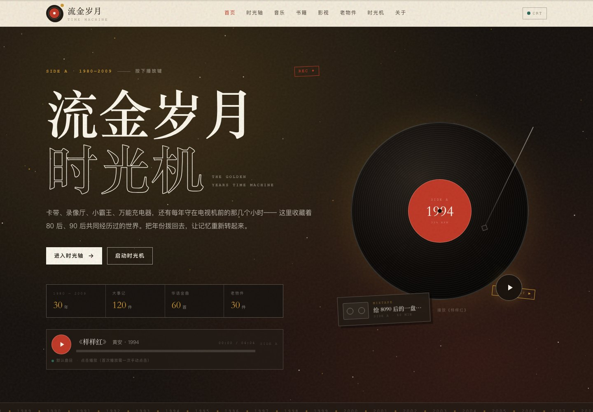 | 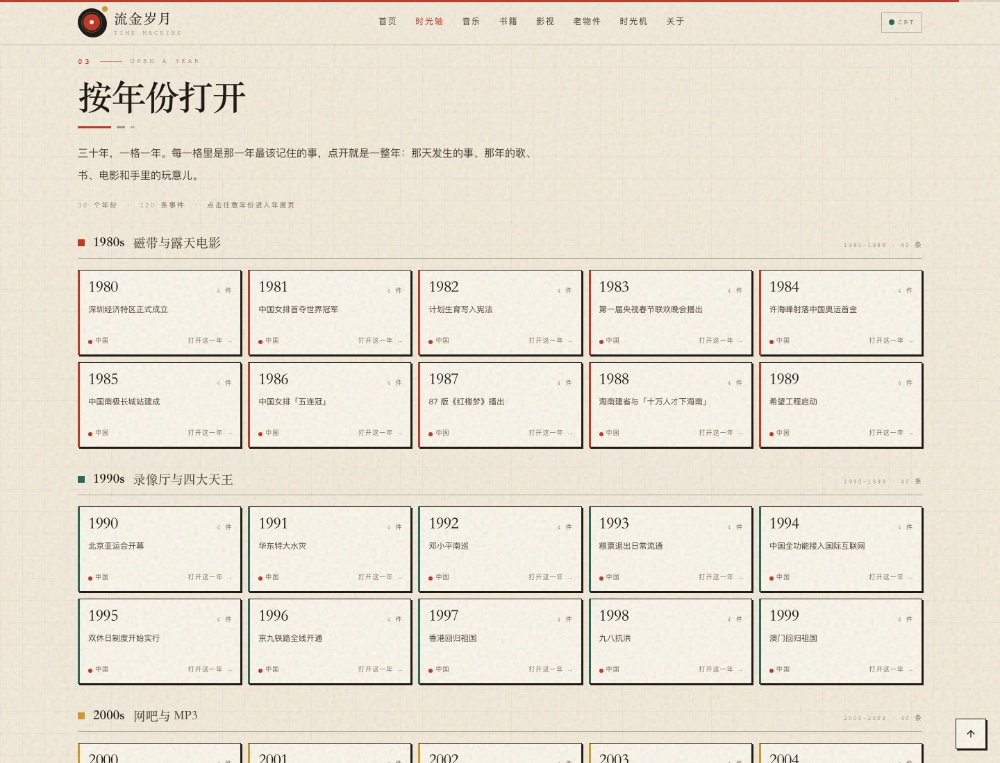 |
| **年度页：1994 年** | **音乐详情页：样样红（可试听）** |
| 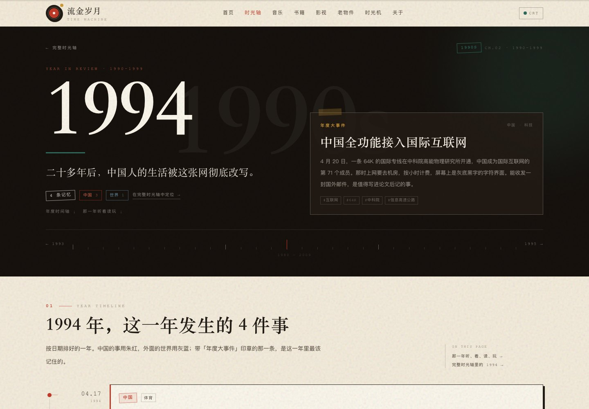 | 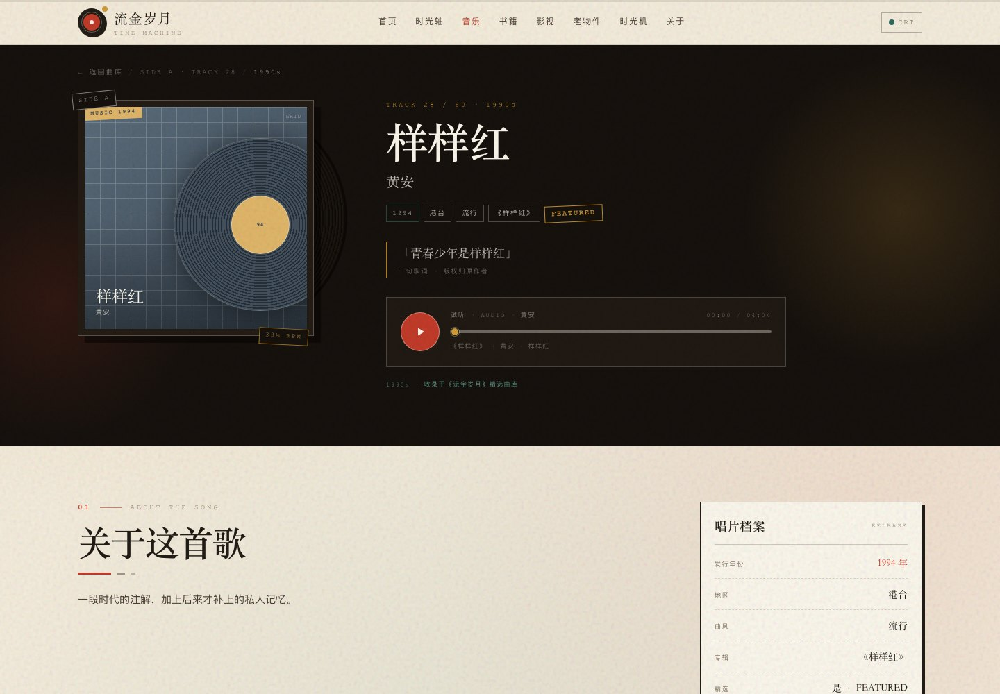 |
| **老物件详情：打陀螺（CC 实拍图）** | **音乐：磁带与黑胶** |
| 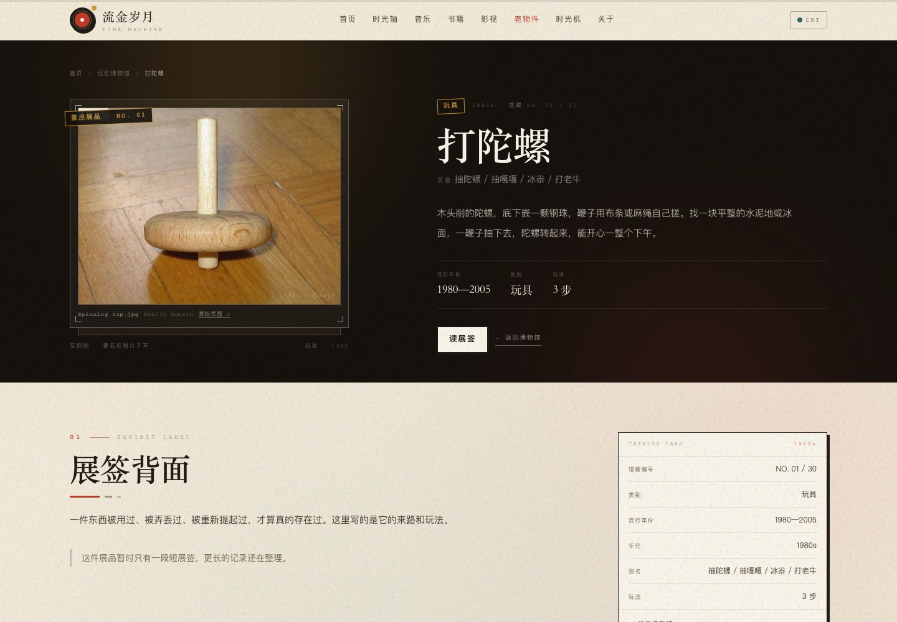 | 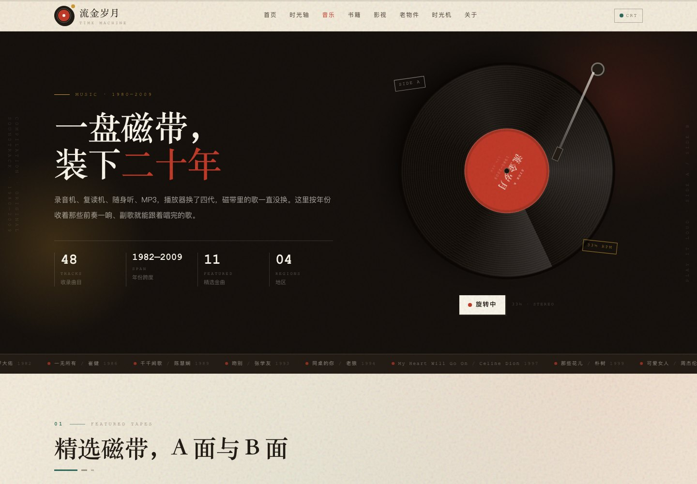 |
| **影视：录像厅与海报墙** | **书籍：书架与借书卡** |
| 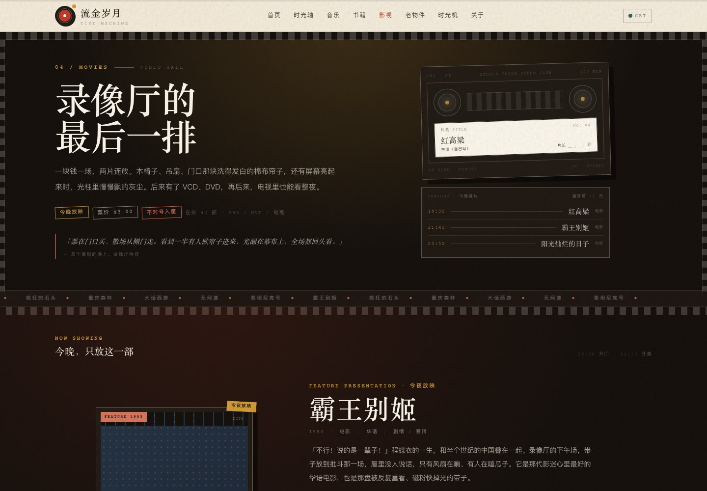 | 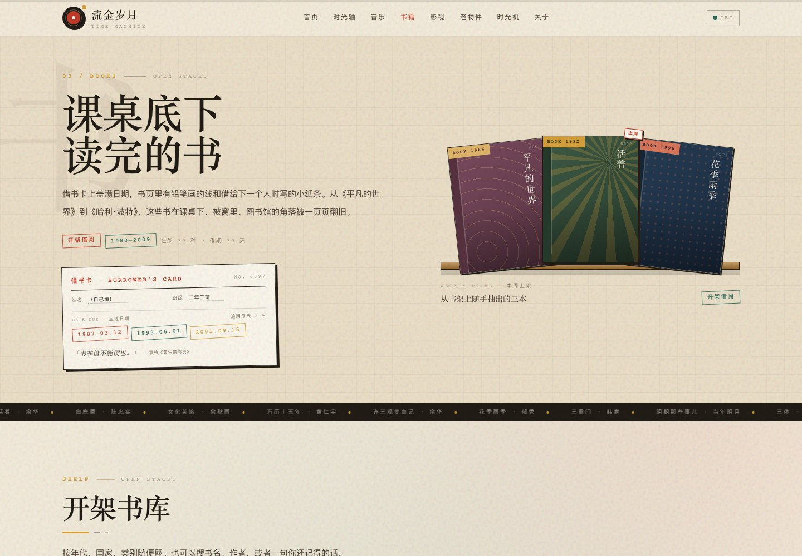 |
| **老物件：记忆博物馆** | **时光机：个人年代记忆卡** |
| 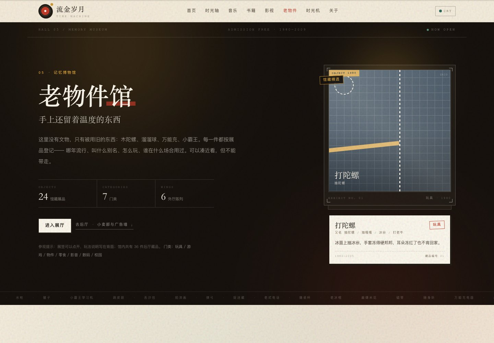 | 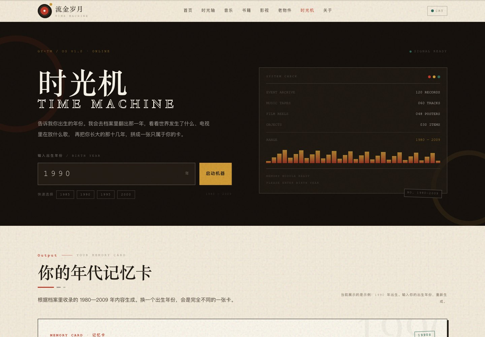 |
| **移动端** | |
| 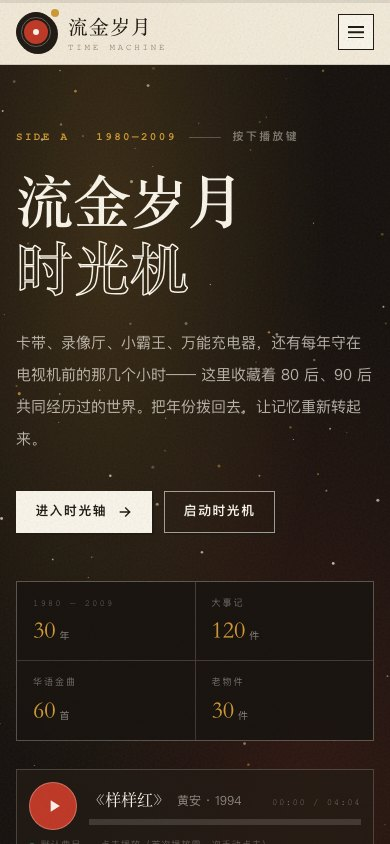 | |

## ✨ 功能

| 板块 | 路由 | 内容 |
| --- | --- | --- |
| 首页 | `/` | 3D「时间隧道」星空、黑胶唱机、年代走马灯、六大板块入口、编辑精选、随机记忆 |
| 时光轴 | `/timeline/` | 1980—2009 共 **120 条**中国/世界大事，滚动生长的时光河流、年代章节、年份快速跳转、地域筛选；30 个年份可「按年份打开」进入独立年度页 |
| 音乐 | `/music/` | **60 首**华语/港台/欧美/日韩金曲，旋转黑胶、SIDE A/B 磁带、年代/地区/曲风筛选；首页黑胶默认播放黄安《样样红》，支持播放/暂停/进度 |
| 书籍 | `/books/` | **36 本**书的书架与借书卡，年代/国家/类别筛选；每本可打开借书卡详情页 |
| 影视 | `/movies/` | **48 部**电影/电视剧/动画片的海报墙与「今夜放映」，主题曲做成磁带标签；每部可打开录像厅档案详情页 |
| 老物件 | `/toys/` | **30 件**童年玩具/老物件 + 小卖部、动画片、广告金句、网吧、老电器、校园生活 6 组扩展；16 张 CC 授权实拍图，每件可打开展签详情页 |
| 时光机 | `/time-machine/` | 输入出生年份，生成个人「年代记忆卡」：那一年的大事、童年在哪几年、年代歌单、玩过的玩具、看过的影视，可复制分享 |
| 关于 | `/about/` | 站点缘起、版权声明、技术说明、留言板（Twikoo 预留） |
| 年度页 | `/timeline/1980/` … `/timeline/2009/` | 每年一个独立页面：年度大事件、按日期排序的年度时间轴、那一年在听/看/读/玩什么、上一年/下一年 |
| 详情页 | `/music/<id>/`、`/books/<id>/`、`/movies/<id>/`、`/toys/<id>/` | 174 个作品详情页：大封面/实拍图、长文故事、歌词/台词/玩法、那一年的大事、同类推荐、上一件/下一件 |
| 404 | `/404.html` | 「信号丢失」的显像管彩蛋页 |

细节：

- **封面程序化 + 实拍图混合**：唱片、书封、电影海报、票根由作品名/年份哈希生成；老物件详情页使用 16 张 Wikimedia Commons 的 CC0/公有领域/CC BY/CC BY-SA 实拍图，本地化存储并在详情页与「关于」页完整署名。
- **可播放的黑胶**：首页黑胶默认选中黄安《样样红》（本地 128kbps 音频，4:04），点击唱片或播放键即可播放/暂停、拖动进度；音乐详情页也支持试听。
- **年度页与详情页**：213 个静态页面全部预渲染，详情页之间通过「那一年」「同年代推荐」「上一件/下一件」互相串联。
- **动效克制**：滚动入场、时间线生长、黑胶旋转、走马灯、CRT 显像管滤镜（导航栏右上角可切换），并完整尊重 `prefers-reduced-motion`。
- **零运行时框架**：交互全部为原生 TypeScript + CSS；three.js 仅在首页按需加载。
- **可访问性**：语义化标签、跳转链接、表单 label、键盘焦点样式、移动端适配。
- **SEO**：每页独立 title/description/canonical/OG，自动生成 `sitemap-index.xml`（212 条 URL）与 `robots.txt`。

---

## 🧱 技术栈

- [Astro 5](https://astro.build/) — 静态站点生成、内容驱动的组件
- [Tailwind CSS 4](https://tailwindcss.com/) — 通过 `@tailwindcss/vite` 集成，设计 token 写在 `src/styles/global.css` 的 `@theme` 中
- [three.js](https://threejs.org/) — 首页「时间隧道」粒子场景（动态 import，`prefers-reduced-motion` 时跳过）
- 原生 Audio / Web Audio 交互（无播放器库）与 [Wikimedia Commons](https://commons.wikimedia.org/) CC 授权图片
- TypeScript（严格模式）
- [Twikoo](https://twikoo.js.org/) — 评论系统，**已预留，尚未接入**（见下文）

无 React/Vue，无第三方动画库，无外部字体请求；图片与音频全部本地化，运行时不请求外部图床。

---

## 🚀 快速开始

需要 Node.js ≥ 20（推荐 20/22 LTS）与 pnpm。

```bash
pnpm install
pnpm dev        # 开发服务器 http://localhost:4321
pnpm build      # 构建静态站点到 dist/
pnpm preview    # 本地预览 dist/
pnpm exec astro check   # TypeScript / Astro 类型检查
```

> 说明：`package.json` 中 TypeScript 固定在 5.x，因为 `astro check` 依赖 TypeScript 的 programmatic API，暂不兼容 TS 7。

---

## 📁 目录结构

```
.
├─ astro.config.mjs          # Astro 配置（站点域名、Tailwind Vite 插件、sitemap）
├─ public/
│  ├─ audio/                 # 本地音频（样样红）
│  ├─ images/objects/        # CC 授权老物件实拍图（webp）
│  └─ favicon.svg / OG / robots.txt
├─ scripts/
│  ├─ shot.sh                # 单屏截图（本机 Chrome 无头模式）
│  ├─ fullshot.mjs           # 整页截图（CDP，无需 puppeteer）
│  └─ probe.mjs              # 在无头浏览器里执行 JS，排查样式/脚本
├─ src/
│  ├─ components/
│  │  ├─ shared/             # BaseLayout 用的共享组件：Nav、Footer、CoverArt、Reveal、SectionHeader、Comment
│  │  ├─ home/               # 首页专用（如有）
│  │  ├─ timeline/           # 时光轴组件
│  │  ├─ culture/            # 音乐 / 书籍 / 影视组件
│  │  └─ nostalgia/          # 老物件组件
│  ├─ data/
│  │  ├─ site.ts             # 站点信息、导航、年代、Twikoo 配置
│  │  ├─ events/             # 1980s / 1990s / 2000s 大事记
│  │  ├─ culture/            # music.ts / books.ts / movies.ts
│  │  ├─ nostalgia/          # toys.ts / extras.ts
│  │  └─ images.ts           # CC 实拍图库 + 授权清单
│  ├─ lib/theme.ts           # 哈希、封面色板、年代工具
│  ├─ layouts/BaseLayout.astro
│  ├─ pages/
│  │  ├─ timeline/[year].astro   # 30 个年度页
│  │  └─ music|books|movies|toys/[id].astro  # 174 个详情页
│  ├─ scripts/               # 前端交互（site / collection / 各页面）
│  ├─ styles/global.css      # 设计系统：配色、字体、噪点、扫描线、工具类
│  └─ types.ts               # 全部数据类型（唯一契约）
├─ docs/                     # 预览图、图片授权清单
└─ dist/                     # 构建产物
```

---

## ✍️ 内容维护

所有内容都在 `src/data/**` 下的 TypeScript 文件里，严格遵循 `src/types.ts`。改完刷新即可看到效果。

### 添加一首歌

```ts
// src/data/culture/music.ts
{
  id: '1998-xxx',              // 全站唯一，小写 + 连字符
  title: '歌名',
  artist: '歌手',
  year: 1998,
  region: '港台',              // 华语 | 港台 | 欧美 | 日韩 | 其他
  album: '专辑名',             // 可选
  genre: '流行',
  lyric: '一句最难忘的歌词',     // 可选，建议 ≤ 25 字
  description: '100 字以内的时代注解，写具体的听歌场景。',
  featured: true,              // 可选：进入首页精选 / SIDE A-B
  // cover: '/images/xxx.jpg', // 可选：留空则使用程序化复古封面
  // audio: '/audio/xxx.mp3',  // 可选：需自行准备音频文件并放到 public/audio/
}
```

- **封面**：默认由 `CoverArt` 根据 id/标题/年份自动生成；如需真实封面，把图片放进 `public/images/`，填 `cover: '/images/xxx.jpg'` 即可。
- **试听**：把 mp3 放进 `public/audio/`，填写 `audio: '/audio/xxx.mp3'`。注意音乐版权，建议只放自己拥有授权的内容或改为外链。
- **书籍 / 影视 / 老物件**：字段见 `src/types.ts`，结构与音乐类似；可选 `story`（200–400 字长文，详情页展示）、`image` / `gallery`（图片）。
- **详情页与年度页**：由 `src/pages/**/[id].astro`、`src/pages/timeline/[year].astro` 根据数据自动生成，新增条目后无需手写页面。
- **时光轴事件**：在 `src/data/events/1980s.ts` / `1990s.ts` / `2000s.ts` 中追加，`scope` 选 `china` 或 `global`，`category` 从既有枚举中选择。

### 添加图片（CC 授权）

1. 把图片放进 `public/images/objects/`（建议 webp，单张 < 250KB）；
2. 在 `src/data/images.ts` 的 `itemImages` 中以条目 id 为键登记 `ImageCredit[]`，填写 `alt / title / author / license / licenseUrl / sourceUrl`；
3. 授权清单会同步展示在 `/about/` 的「图片来源」，并出现在详情页图片下方。

只使用 CC0 / 公有领域 / CC BY / CC BY-SA 等授权清晰的图片，不要使用影视海报、专辑封面或来源不明的图片。

### 修改站点信息

编辑 `src/data/site.ts`：站点标题、描述、关键词、起始年份、导航、年代文案、Twikoo 配置。修改后记得同步 `astro.config.mjs` 的 `site` 与 `public/robots.txt` 里的域名。

### 调整视觉

`src/styles/global.css` 的 `@theme` 定义了全部颜色与字体 token（`--color-paper`、`--color-vermilion`、`--font-display` 等），改这一处即可全站换肤。

---

## 💬 接入 Twikoo 评论（腾讯云）

留言板组件已经写好，未配置时显示「留言板即将开启」的占位卡片，**不会影响构建**。

1. 参照 [Twikoo 官方文档](https://twikoo.js.org/) 在腾讯云部署后端：
   - 云函数 SCF（Node.js 环境）+ MongoDB（可用 MongoDB Atlas 免费版）；
   - 或使用 Vercel / 自建 Docker。
2. 得到环境 ID（或自建后端地址）后，二选一：
   - 打开 `src/data/site.ts`，填写：
     ```ts
     twikoo: {
       envId: '你的环境ID',
       cdn: 'https://cdn.jsdelivr.net/npm/twikoo@1.6.44/dist/twikoo.all.min.js',
       placeholder: '说点什么吧……',
     }
     ```
   - 或在构建时注入环境变量：
     ```bash
     PUBLIC_TWIKOO_ENV_ID=你的环境ID pnpm build
     ```
3. 重新构建即可。`/about/` 页底部的留言板会自动初始化；如需在其他页面使用，导入 `src/components/shared/Comment.astro`。

> 腾讯云函数默认域名在部分网络下访问较慢，建议绑定自定义域名并配置 HTTPS；`cdn` 字段也可换成国内可访问的 Twikoo CDN。

---

## ☁️ 部署

`pnpm build` 产出的 `dist/` 是纯静态文件，任选其一：

### 腾讯云 COS 静态网站托管

1. 新建存储桶，开启「静态网站」功能；
2. 上传 `dist/` 内全部文件到桶根目录；
3. 默认首页填 `index.html`，错误文档填 `404.html`；
4. 绑定自定义域名并配置 HTTPS 证书。

> 若部署在子路径（如 `/golden-years/`），需在 `astro.config.mjs` 设置 `base: '/golden-years'`，并同步调整站内绝对链接（当前导航使用根路径）。

### 腾讯云 EdgeOne Pages / Vercel / Netlify / Cloudflare Pages

- 构建命令：`pnpm build`
- 输出目录：`dist`
- Node 版本：20 或 22

### 自建 Nginx

```nginx
server {
  listen 80;
  server_name golden-years.example.com;
  root /var/www/golden-years/dist;
  index index.html;
  location / { try_files $uri $uri/ $uri.html /404.html; }
}
```

构建后如发现中文路径或路由问题，检查 `dist/` 下是否生成了对应目录的 `index.html`。

---

## 🎨 截图与视觉验收

仓库内置了无额外依赖的截图脚本（使用本机 Google Chrome）：

```bash
# 单屏截图
./scripts/shot.sh http://127.0.0.1:4321/timeline/ .shots/timeline.png 1440 1200

# 整页截图（会滚动触发入场动效）
node scripts/fullshot.mjs http://127.0.0.1:4321/ .shots/home-full.png 1440 900

# 在页面里执行 JS 排查问题
node scripts/probe.mjs http://127.0.0.1:4321/ "getComputedStyle(document.querySelector('h1')).fontSize"
```

> 脚本路径中的 Chrome 固定为 macOS 的 `/Applications/Google Chrome.app/...`，其他系统请自行修改。

---

## 📄 内容与版权

- **代码**：以 MIT License 发布（见仓库根目录 `LICENSE`），可自由修改、二次开发。
- **文案**：站内文字为原创整理，欢迎在注明出处的前提下引用。
- **歌曲/影视/书籍名称、歌词与台词**：版权归原作者及权利方所有，本站仅作怀旧交流与文化评论用途，引用为短句节选；未提供任何音视频下载。
- **图片**：唱片/书封/海报为程序化生成的抽象图形；老物件实拍图来自 Wikimedia Commons，按 CC 授权使用并在页面与 `docs/image-credits.md` 中署名。若你替换为其他图片，请自行确认版权。
- **音频**：首页与《样样红》详情页的音频由站长提供，仅作个人怀旧展示；如需公开部署，请自行确认音乐版权或替换为已授权音频。
- 如权利人认为内容不妥，请联系删除。

---

## 🗓 更新日志

- **v1.1.0** — 第二轮迭代（2026-10）：
  - 首页黑胶播放器：默认黄安《样样红》，支持播放/暂停/拖动进度，黑胶随播放转动；
  - 时光轴 30 个年度页 + 「按年份打开」年份索引，每年有独立的年度大事件与年度时间轴；
  - 数据扩充：120 条事件、60 首歌、36 本书、48 部影视、30 件老物件；
  - 174 个作品详情页（音乐 / 书籍 / 影视 / 老物件），带长文故事、那一年、同类推荐、上一件/下一件；
  - 16 张 CC 授权老物件实拍图，「关于」页新增图片来源与授权说明。
- **v1.0.0** — 首版上线（2026-10）：首页 3D 时间隧道、时光轴（1980—2009）、音乐 / 书籍 / 影视 / 老物件四大收藏、交互式时光机、关于页与 Twikoo 预留、404 彩蛋、sitemap 与 SEO。
